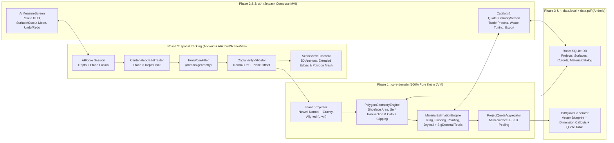

# AR Contractor Quote & Material Estimation App — Master Engineering Plan

> **Architecture Status:** **Phases 10–13 Complete & Verified** (`:core-domain:test` 40/40, `:app:testDebugUnitTest` 109/109, `:app:lintDebug` 0 issues, `:app:assembleDebug`, `:app:assembleRelease`, `:app:compileDebugAndroidTestKotlin` green) — **App finalized and shipping signed APKs through an auto-updating GitHub Release**
> **Target Platform:** Native Android (Min SDK 26 / Target SDK 35 / Compile SDK 36, Kotlin 2.2.0, Jetpack Compose Material 3)  
> **Offline Guarantee:** 100% On-Device Spatial Math, Room Persistence, and Vector `PdfDocument` Generation (Zero Cloud Dependencies)

---

## 1. Executive Architecture Overview

This document serves as the **single source of truth** across engineering agents and implementation phases. Every module boundary, mathematical invariant, coordinate convention, and data contract is explicitly locked here so multiple agents can execute or audit subsystems concurrently without interface drift.



---

## 2. Multi-Agent Ownership & Compile-Time Module Boundaries

To guarantee that `domain.geometry` and `domain.estimation` remain **100% free of Android framework dependencies**, the Gradle build is partitioned into two modules:

| Gradle Module | Package Namespace | Allowed Dependencies | Owning Phase / Agent Role |
| :--- | :--- | :--- | :--- |
| `:core-domain` | `com.arcontractor.estimator.domain.geometry` | Kotlin Stdlib, `java.math.BigDecimal`, JUnit 5 / JUnit 4 | **Phase 1** — Spatial Math & Geometry Agent |
| `:core-domain` | `com.arcontractor.estimator.domain.estimation` | `:core-domain` (`domain.geometry`), Kotlin Stdlib | **Phase 1** — Estimation & Costing Agent |
| `:app` | `com.arcontractor.estimator.spatial.tracking` | `:core-domain`, ARCore, SceneView (`arsceneview`), Coroutines | **Phase 2** — ARCore & Filament Rendering Agent |
| `:app` | `com.arcontractor.estimator.ui.ar` | `:core-domain`, `spatial.tracking`, Compose M3, Lifecycle VM | **Phase 2** — Spatial HUD & Compose UI Agent |
| `:app` | `com.arcontractor.estimator.data.local` | `:core-domain`, Room Runtime/KTX/KSP, Coroutines | **Phase 3** — Persistence & Catalog Agent |
| `:app` | `com.arcontractor.estimator.ui.quote` | `:core-domain`, `data.local`, Compose M3 | **Phase 3** — Quote MVI & Catalog UI Agent |
| `:app` | `com.arcontractor.estimator.data.pdf` | `:core-domain`, `android.graphics.pdf.PdfDocument`, `Canvas` | **Phase 4** — Vector Blueprint & PDF Engine Agent |

---

## 3. Architectural & Mathematical Improvements (Beyond Baseline Spec)

As Principal Spatial Computing Architects, we have incorporated **9 production-hardening improvements** addressing real-world jobsite failure modes:

1. **Compile-Time Pure JVM Isolation (`:core-domain`):**
   - Rather than relying on developer discipline inside `app/src/main`, `:core-domain` is a pure `org.jetbrains.kotlin.jvm` Gradle module. Importing `android.*` is a compile error, and `./gradlew :core-domain:test` runs instantaneously on any CI/local JVM without Robolectric or an emulator.
2. **Velocity-Adaptive & Jump-Guarded EMA Pose Filter (`EmaPoseFilter`):**
   - Supports deterministic fixed-$\alpha$ smoothing **plus** optional velocity-adaptive $\alpha \in [\alpha_{\min}, \alpha_{\max}]$ (heavy damping during fine corner aiming to kill hand-shake; low lag during fast camera sweeps) and depth-discontinuity jump recovery (`maxSnapDistanceMeters`) with spherical/renormalized surface normal smoothing.
3. **Newell's Method Best-Fit Plane + Gravity-Aligned Basis (`PlanarProjector`):**
   - Real ARCore `DepthPoint` anchors exhibit $\pm 2\text{--}15\text{ mm}$ depth noise, and the first 3 placed vertices along a baseboard or doorframe may be nearly collinear.
   - Instead of a fragile 3-point cross product, we compute the plane centroid and **Newell's method** area-weighted normal across *all* $N$ vertices (oriented consistently with an optional reference normal from ARCore's camera-facing hit pose).
   - **Gravity-Aligned `(u, v)` Axes:** For vertical/sloped walls ($|\mathbf{n} \cdot \mathbf{Y}_{\text{up}}| < 0.95$), $+\mathbf{v}$ is aligned with projected world-up $(0, 1, 0)$ and $+\mathbf{u}$ runs horizontally right. For horizontal floors/ceilings, $+\mathbf{u}$ aligns with the primary measured baseline edge. Result: **2D PDF blueprints always render walls upright with level floors and plumb doors/windows**, never tilted at arbitrary angles.
4. **Dual-Gate Coplanarity Validator (`CoplanarityValidator`):**
   - Checks **both** normal angular deviation ($\mathbf{n}_{\text{hit}} \cdot \mathbf{n}_{\text{ref}} \ge \cos \theta_{\max}$) **and** signed orthogonal plane offset ($|(\mathbf{p}_{\text{hit}} - \mathbf{p}_{\text{ref}}) \cdot \mathbf{n}_{\text{ref}}| \le d_{\max}$).
   - Prevents two common jobsite bugs: (a) wall vertices snapping onto an adjacent floor/ceiling plane, and (b) raycasts passing through an open doorway and snapping onto a parallel hallway wall 1.5 m behind the target wall.
5. **Surface Flatness / Scan Quality RMS Diagnostic (`PlanarSurfaceMetrics`):**
   - Retains each vertex's orthogonal residual distance $w_i = (\mathbf{p}_i - \mathbf{o}) \cdot \mathbf{n}$ from the best-fit plane, computing `rmsPlanarErrorMeters` and `maxPlanarDeviationMeters`. Contractors immediately see if a wall/subfloor is out-of-flat (e.g., $> 6\text{ mm}$ over $3\text{ m}$ requiring self-leveling compound or wall skimming before large-format tile).
6. **Boundary-Flush & Overlap-Safe Boolean Cutout Engine (`PolygonGeometryEngine`):**
   - Doors touch the bottom floor edge of a wall polygon ($v = 0$), which breaks naive strict point-in-polygon tests.
   - Our geometry engine validates self-intersections, enforces deterministic CCW/CW winding, supports **boundary-flush interior cutouts** (doors, baseboards, edge notches), and computes **exact boolean clipped areas** (via Sutherland-Hodgman / convex-triangulated polygon clipping + union overlap protection) so overlapping or edge-sharing cutouts never double-subtract or produce negative net area, while preserving exact `cutoutPerimeterMeters` for bullnose/J-bead/casing trim.
7. **Trade-Specific Volumetric Consumables Formulas (`MaterialEstimationEngine`):**
   - **Tiling:** Industry volumetric grout mass formula accounting for tile length, width, thickness, joint width, and cementitious density ($1.65\text{ g/cm}^3$), trowel-notch-aware thinset mortar bag estimation, and edge-trim strips from `cutoutPerimeterMeters`.
   - **Flooring:** Box rounding, underlayment rolls, and perimeter baseboard/quarter-round linear footage with miter waste.
   - **Painting:** Multi-coat finish paint gallons + optional primer coats + perimeter painter's tape rolls.
   - **Drywall:** Sheet count ($4\times 8$ / $4\times 12$), joint compound buckets, seam tape rolls, screw boxes, and cutout J-bead/corner bead strips.
   - **Phase 6 union-aware trim perimeter:** Trim/bead/tape quantities are driven by `effectiveCutoutPerimeterMeters` — each cutout boundary edge is split at parent/sibling crossings, segments outside the parent or strictly inside another opening are dropped, and shared collinear edges are deduplicated so overlapping openings never double-bill trim. `cutoutPerimeterMeters` remains the raw diagnostic sum.
   - **Phase 6 door threshold deduction:** `doorOpeningWidthMeters` sums the horizontal widths of `CutoutKind.DOOR` thresholds flush with the parent's bottom boundary; flooring baseboard runs subtract this width before applying miter waste. Elevated door-shaped cutouts (pass-throughs) do not reduce baseboard.
8. **Deterministic Financial Arithmetic (`BigDecimal` + `HALF_UP`) & Multi-Surface Aggregation:**
   - All monetary line items (`materialSubtotal`, `consumablesSubtotal`, `laborSubtotal`, `taxAmount`, `grandTotal`) use `BigDecimal` scaled to 2 decimal places (`RoundingMode.HALF_UP`) so itemized line items always sum to the exact penny on client invoices.
   - Includes `ProjectQuoteAggregator` to roll up multi-wall / multi-room scans into a single client quote.
9. **Blank-Wall AR Resilience & CAD Blueprint Readability (Phases 2–4 Ready):**
   - Phase 2 combines Plane + DepthPoint hit-testing with feature-starvation feedback for freshly primed white drywall, plus a non-destructive Undo/Redo vertex command stack.
   - Phase 4 `PdfDocument` blueprint renderer draws outward-offset dimension leader lines, hatched cutout polygons, scale bar, and metric/imperial dual-unit labels.

---

## 4. Coordinate & Unit Conventions (Cross-Agent Contract)

- **World 3D Coordinate System:** Right-handed Y-up (matches ARCore & OpenGL/Filament): $+\mathbf{X}$ right, $+\mathbf{Y}$ up (opposite gravity), $-\mathbf{Z}$ camera forward at session origin. All internal spatial coordinates are in **meters (`Double`)**.
- **Planar 2D Coordinate System:** Orthonormal right-handed basis $(\mathbf{u}, \mathbf{v}, \mathbf{n})$ anchored at polygon centroid $\mathbf{o} \in \mathbb{R}^3$, where $\mathbf{u} \times \mathbf{v} = \mathbf{n}$. Coordinates $(u_i, v_i)$ are in **meters (`Double`)**.
- **Display & Pricing Units:** Core geometry operates in SI meters (`m`, `m²`); `UnitConverter` provides lossless conversion to Imperial (`ft`, `ft²`, architectural `ft'-in"`) so contractors can price labor/materials in either `SQ_METER` or `SQ_FOOT`.

---

## 5. Phased Execution Tracker

### Phase 1: Project Foundation, Pure Geometry Engine & Estimation Engine
- [x] `MASTER_PLAN.md` architectural specification & cross-agent contracts
- [x] Gradle multi-module setup (`settings.gradle.kts`, `build.gradle.kts`, `gradle/libs.versions.toml`, `:core-domain`, `:app`)
- [x] `domain.geometry`:
  - [x] `Vec3`, `Vec2`, `Pose3D`, `PlanarBasis` value/data structures & linear algebra operations
  - [x] `EmaPoseFilter` (fixed & velocity-adaptive EMA + normal renormalization + jump threshold)
  - [x] `CoplanarityValidator` (normal dot-product angle gate + orthogonal plane-distance gate)
  - [x] `PlanarProjector` (Newell best-fit plane, gravity-aligned orthonormal basis, 3D↔2D projection, flatness RMS metrics)
  - [x] `PolygonGeometryEngine` (Shoelace signed/unsigned area, winding normalization, self-intersection check, segment lengths, perimeter, boolean cutout subtraction & clipping)
  - [x] `UnitConverter` (meters ↔ feet/inches, $\text{m}^2 \leftrightarrow \text{ft}^2$)
- [x] `domain.estimation`:
  - [x] `TradeType`, `WastePreset`, `PricingUnit`, `MaterialSpec`, `ConsumableItem`, `SurfaceEstimate`, `ProjectQuoteSummary`
  - [x] `MaterialEstimationEngine` (gross area with waste, `ceil` box/sheet/gallon rounding, trade-specific consumables, `BigDecimal` itemized subtotals, labor, tax, grand total)
  - [x] `ProjectQuoteAggregator` (multi-surface quote roll-up)
- [x] Comprehensive JVM JUnit test suites (`:core-domain:test`) covering tilted planes, concave L-shaped rooms, wall door/window cutouts, overlapping cutouts, jitter smoothing, coplanarity rejection, and all 4 trades' estimation math

### Phase 2: ARCore + SceneView Spatial Pipeline & Compose HUD *(Complete & Verified)*
- [x] `spatial.tracking.ArSessionController`: ARCore configuration (`Config.DepthMode.AUTOMATIC`, `PlaneFindingMode.HORIZONTAL_AND_VERTICAL`, `InstantPlacementMode.DISABLED` for metric accuracy)
- [x] `spatial.tracking.ReticleHitTester`: Continuous center-screen `Frame.hitTest` prioritizing `Plane` (within polygon) > `DepthPoint`, piped through `EmaPoseFilter` and `CoplanarityValidator`
- [x] `spatial.tracking.PolygonSceneRenderer`: Filament/SceneView 3D vertex sphere nodes, dynamic cylinder/line edge extrusions, translucent triangulated surface fill, and red cutout wireframes
- [x] `ui.ar.ArMeasureViewModel` & `ArMeasureScreen`: Unidirectional MVI state machine (`Scanning` → `LockingPlane` → `PlacingOuterBoundary` → `PlacingCutout` → `Completed`), live dimension pills, flatness badge, Undo/Redo/Close Polygon controls

### Phase 3: Room Persistence, Material Catalog & Quote Summary UI *(Complete & Verified)*
- [x] `data.local`: singleton Room database (`AppDatabase`), project/surface/cutout/material entities, JSON vertex and trade-parameter converters, foreign-key-safe DAOs, exported schema, and idempotently seeded contractor material catalog
- [x] `data.repository.ProjectRepository` & `MaterialCatalogRepository` with `Flow` reactive queries, default-project bootstrap, raw-anchor reconstruction, live catalog/tax recomputation, and surface pricing overrides
- [x] `EstimatorApplication` / `AppContainer`: offline database singleton, repository wiring, startup seeding, and Compose ViewModel factory
- [x] AR-to-quote handoff: completed measurements save raw 3D anchors and cutouts, then open the quote workspace with the saved surface selected
- [x] `ui.quote`: material catalog editor, surface material selector, trade waste presets/custom allowance, labor override, project tax policy/rate adjuster, coverage ledger, itemized totals, and responsive real-time quote summary
- [x] Persistence/UI tests: converter and trade-parameter round-trips, idempotent seeding, FK-safe deletion, raw-anchor reconstruction, pricing/tax invalidation, AR measurement save, and quote catalog actions

### Phase 4: Native Vector Blueprint & PDF Quote Generator *(Complete & Verified)*
- [x] `data.pdf.BlueprintCanvasRenderer`: Aspect-preserving 2D $(u_i, v_i)$ bounding-box normalization, outer polygon stroke/fill, diagonal-hatched cutout zones, outward-offset edge dimension labels, scale bar, and surface summary legend
- [x] `data.pdf.PdfQuoteGenerator`: Multi-page A4/Letter `PdfDocument` layout with contractor branding header, client metadata, vector blueprint diagram, itemized materials/consumables/labor table, tax/total summary, validity date, and client signature block + Android `FileProvider` share sheet integration

### Phase 5: Final-Review Hardening *(Complete & Verified)*
- [x] AR readiness checks, runtime camera permission/install handling, unsupported-device guidance, camera/settings recovery, and re-creatable session error states
- [x] Runtime ARCore depth capability detection with plane-only fallback and depth-occlusion gating
- [x] Locked-surface normal normalization for depth hits and recoverable tracking/session state transitions
- [x] Deterministic project-level tax allocation so surface totals reconcile exactly with cover, itemized, and project totals
- [x] Cent-normalized labor unit prices so displayed unit price × quantity equals the line total
- [x] Complete paginated surface-summary pages for quotes with more than eight surfaces
- [x] Revisioned private PDF filenames, bounded export cleanup, and explicit Android backup/data-extraction exclusions
- [x] SavedStateHandle restoration of in-progress AR measurements with lifecycle-only persistence and startup-only catalog seeding
- [x] Release/R8 verify, explicit serialization keep rules, zero lint warnings, and share-sheet string extraction

### Phase 6: Quote-Correctness Fixes *(Complete & Verified)*
- [x] Union-aware `effectiveCutoutPerimeterMeters` on `SurfaceGeometryMetrics` / `AnalyzedSurfacePolygon` / `AnalyzedCutout` (overlap-safe, protrusion-clipped, shared-edge-deduplicated trim perimeter)
- [x] `MaterialEstimationEngine` trim, J-bead, and painter's tape consume the effective perimeter; raw perimeter kept for diagnostics
- [x] `doorOpeningWidthMeters` floor-flush door detection; flooring baseboard run skips door thresholds with explicit calculation basis
- [x] Full 0–100% project tax range accepted end-to-end; out-of-range values rejected with a user-facing error instead of a silent 30% clamp; slider widened to 0–100%
- [x] Invalid stored pricing overrides (unknown waste preset, out-of-range factor, negative labor) degrade to material defaults with per-surface `loadErrors` instead of crashing the workspace Flow
- [x] Regression tests: overlapping/protruding/flush/disjoint cutout perimeters, door vs pass-through widths, door baseboard deduction, union trim billing, high & invalid tax rates, corrupt preset degradation

### Phase 7: Manual Entry & Surface Repair *(Complete & Verified)*
- [x] `domain.geometry.ManualSurfaceBuilder`: synthesizes planar wall/floor vertex rings and rectangular cutouts from typed dimensions (pure JVM, same analysis pipeline as AR)
- [x] `replaceSurfaceMeasurement` repository operation preserving surface ID, material assignment, pricing overrides, and creation order
- [x] Manual-entry dialog: metric/feet units, wall/floor orientation, named rectangular openings with kind + offsets, validation errors surfaced inline
- [x] Quote header "Manual" action and empty-state "Enter dimensions" path so non-AR devices produce complete quotes
- [x] Surface repair: "Fix dimensions" / "Re-enter dimensions" (manual) and "Re-measure in AR" (nav-arg targeted capture) replace broken or outdated measurements in place
- [x] `MeasurementCapture.replaceSurfaceId` routes both AR and manual saves through in-place replacement
- [x] Tests: manual wall/floor analysis parity, imperial conversion, replacement identity/pricing, invalid-input rejection, AR targeted replacement

### Phase 8: Multi-Project & Currency *(Complete & Verified)*
- [x] Room schema v3: `projects.currencyCode` (default `USD`), `MIGRATION_2_3`, exported schema, Robolectric `MigrationTestHelper` validation
- [x] Repository: `createProject`, `deleteProject` (last-project guard), `observeProjects`, ISO 4217 currency validation on metadata updates
- [x] Project switcher dialog from the ledger header: list/create/switch/delete with confirmation; active project persists across bootstrap
- [x] Currency picker in project details (common chips + free ISO code)
- [x] All UI money (`formatMoney`/`formatRate`, totals, surface rows, pricing panel, catalog) renders the project currency
- [x] Every PDF money value (cover hero, breakdown, summary tables, blueprint facts, line items, totals, acceptance) uses `workspace.project.currencyCode`
- [x] Tests: project lifecycle (create/switch/delete/last-guard), currency propagation, symbol formatting, schema migration

### Phase 9: Polish & Hardening *(Complete & Verified)*
- [x] GitHub Actions CI: JDK 21, domain tests + app unit tests + lint + debug APK, failure-report artifacts
- [x] Single startup bootstrap owner (`QuoteViewModel`); removed racing `AppContainer.initialize`
- [x] Shared `CoplanarityConfig.MEASUREMENT_STANDARD` across reticle, state machine, and saved-surface reconstruction
- [x] AR hot-path: sub-millimeter reticle updates suppressed (no per-frame UiState churn); 64-corner polygon cap with split-surface guidance
- [x] Metric/imperial display toggle for all quote area/perimeter readouts (storage stays SI; PDFs keep dual units)
- [x] Test gaps closed: `MeasurementStateCodec` round-trips + corrupt payloads, tax allocation edges (empty/single/tied-remainder/0%/100%)
- [x] Repo hygiene verified: no tracked `.DS_Store`/`local.properties`; LICENSE still pending owner decision
- [ ] Post-save vertex nudging in the quote workspace (deferred; manual re-entry + AR re-measure cover corrections today)

---

### Phase 10: Critical Functional, AR Lifecycle & R8 Correctness *(Complete & Verified)*
- [x] `saveMeasurement()` writes into the active project (`projectId ?: ensureDefaultProject()`); project #2 AR/manual saves and in-place replacement work
- [x] Project create confirmation preserved through `bootstrap()`; deleting the active project switches observers before deletion (no transient "project could not be found")
- [x] Surface waste preset overrides beat a catalog material's `CUSTOM` waste factor in both `applyOverrides()` and `applyOverridesSafely()`
- [x] Corrupt `CutoutEntity.kind` rows degrade to per-surface `loadErrors`; `updateSurfaceSettings()` validates the preset name
- [x] Thread-safe money formatting (per-thread `NumberFormat` cache); `Uri.encode()` on the `surfaceId` route arg; guarded PDF share intent
- [x] Runtime CAMERA permission flow (grant / permanently-denied → settings), ARScene gated on `hasCameraPermission && READY && no error`, bounded readiness polling for `UNKNOWN_CHECKING`, `ON_RESUME` recovery that clears resolved blocks and restarts the session, `renderer.clear(nodes)` on restart
- [x] `ReticleHitTester.validateAgainstLock()` compares the real hit normal (plane hits can no longer self-validate)
- [x] R8 keep rules for every name-persisted enum and serialization DTO; verified in `mapping.txt` (`CutoutKind.DOOR` unrenamed)
- [x] Regression tests: `:core-domain:test` 40/40, `:app:testDebugUnitTest` 91/91 (12 new), `:app:lintDebug` clean, `:app:assembleRelease` green

---

### Phase 11: Mobile UI Polish, Dialog Feedback & App Finalization *(Complete & Verified)*
- [x] `QuoteHeader` adaptive below 520 dp (project row + wrapping action `FlowRow`); `QuoteTitleRow`, `EmptyLedgerPanel` and `SurfacePricingPanel` action rows use `FlowRow` — zero horizontal overflow at 360 dp
- [x] `DialogErrorBanner` renders validation errors inside `ManualSurfaceDialog`, `ProjectDetailsDialog`, `ProjectSwitcherDialog`, `PdfExportDialog` instead of behind the scrim
- [x] Manual cutout chips scroll horizontally; "Re-enter dimensions" prefills the saved bounding width/height + orientation
- [x] Catalog editor uses the project `currencyCode` and honours `displayUnits`; labor and tax rates accept exact decimals (LKR/INR/JPY and 8.25% tax)
- [x] AR HUD prints `m²` and exposes a metric/imperial toggle (geometry stays SI)
- [x] PDF cover hero total auto-scales 30pt → 16pt so long totals never collide with the facts column
- [x] Launcher icon (colour + monochrome) refitted inside the 66×66 dp safe zone (all miters and the accent dot within radius 30 of `(54,54)`)
- [x] Verification: `:app:testDebugUnitTest` 98/98, `:app:lintDebug` 0 issues, `:app:assembleRelease` green

### Phase 12: Release Signing, Dynamic Versioning & Auto-Updating GitHub Releases *(Complete & Verified)*
- [x] `signingConfigs.release` gated on all four signing values; local unsigned `assembleRelease` still works
- [x] `versionCode`/`versionName` from `-P` flags; `BuildConfig.GIT_SHA` + `GITHUB_REPO`; `isShrinkResources = true`
- [x] Room schema JSON moved to `debug`/`androidTest` assets — confirmed absent from the release APK
- [x] `-PsplitApks` → `arm64-v8a` (10.7 MB), `armeabi-v7a` (9.1 MB), `universal` (33.3 MB)
- [x] `release-apk.yml`: verification gate → monotonic `versionCode` → keystore decode → signed build → `apksigner verify` per APK → `SHA256SUMS.txt` + `version.json` → rolling `latest` / immutable `vX.Y.Z` release; `mapping.txt` artifact; always-run keystore cleanup
- [x] `android-ci.yml` builds the release variant and asserts enum class names in `mapping.txt` plus enum constants in the shipped DEX
- [x] Apache-2.0 `LICENSE` + `NOTICE`; README download/verify, signing setup, and tag-release instructions
- [x] Live verification: `latest` release published with versionCode 208 / 1.0.108, APK SHA-256 matches `SHA256SUMS.txt`, `apksigner` cert SHA-256 matches the release keystore

### Phase 13: In-App GitHub Release Update Checker *(Complete & Verified)*
- [x] `INTERNET` + `REQUEST_INSTALL_PACKAGES`; `apk-updates/` cache path registered with `FileProvider`
- [x] `GitHubUpdateChecker`: single GET on `version.json` (8 s timeouts, `HttpURLConnection`), SHA-256 verified download that deletes mismatched files, ABI-aware `bestVariant()`
- [x] `UpdateCoordinator` (Android gateway) + `UpdateGateway` interface so the ViewModel stays context-free
- [x] Dismissible update banner with Download, plus "Check for updates" beside the version footer; offline/corrupt/failed checks never block the workspace
- [x] Tests: newer/equal/older versionCode, corrupt JSON, offline, checksum mismatch/match, variant preference, banner/dismiss/latest/failure flows
- [x] Verification: `:app:testDebugUnitTest` 109/109, `:app:lintDebug` 0 issues, `:app:assembleRelease` green

---

## 6. Cross-Agent Handoff Contracts (Phases 1 → 4)

### A. Phase 1 → Phase 2 (`domain.geometry` → `spatial.tracking` & Filament 3D Mesh)
- **Live Reticle Smoothing:** `ReticleHitTester` converts ARCore `HitResult.hitPose` into `Pose3D(position, normal, frame.timestamp)` and invokes `EmaPoseFilter.update(rawPose)`. When `FilteredPoseResult.isStableForLock == true`, the Compose reticle transitions to locked-ready state.
- **Plane Lock Enforcement:** Once vertex #1 is placed (`lockedReferencePose`), subsequent hits are gated by `CoplanarityValidator.validatePose(lockedReferencePose, candidatePose)` (and once $N \ge 3$, `validateAgainstBasis(basis, candidatePosition, candidateNormal)`).
- **Hole-Punched 3D Surface Shader Mesh:** `PolygonGeometryEngine.analyze3DSurface(...)` outputs `netSurfaceMeshTriangles2D: List<Triangle2D>`. Phase 2 maps each 2D triangle vertex back into 3D world space via `basis.unprojectTo3D(pt2D, normalOffsetMeters = 0.002)` ($2\text{ mm}$ along $+\mathbf{n}$ to eliminate depth z-fighting against real walls/floors!) so interior windows and doors appear as genuine transparent holes in the AR polygon mesh.

### B. Phase 1 → Phase 3 (`domain.*` → `data.local` Room Persistence)
- Persist **raw 3D anchors** (`outerVertices3D: List<Vec3>`, `referenceNormal: Vec3?`, and `cutouts: List<CutoutPolygonInput>`) in Room alongside `MaterialSpecEntity`.
- Reconstruct `AnalyzedSurfacePolygon` and `SurfaceEstimate` deterministically on load via `PolygonGeometryEngine.analyze3DSurface(...)` and `MaterialEstimationEngine.estimateSurface(...)` so derived metrics never go stale when material specs or waste presets are edited.

### C. Phase 1 → Phase 4 (`domain.*` → `data.pdf` Vector Blueprint & Quote PDF)
- **Blueprint Viewport Mapping:** Use `AnalyzedSurfacePolygon.boundingBox2D` (`minU`, `minV`, `maxU`, `maxV`) to compute uniform aspect-preserving scale $s = \min(W_{\text{box}} / \Delta u, H_{\text{box}} / \Delta v)$ with $12\%$ margin for dimension callouts. Note Android `Canvas` $+Y$ points downward while planar $+v$ points upward: map $(u, v) \mapsto (x_0 + (u - u_{\min}) \cdot s,\; y_0 + (v_{\max} - v) \cdot s)$ so gravity-aligned walls render right-side-up!
- **Non-Overlapping Dimension Callouts:** Offset each edge's length label outward using `EdgeSegment.outwardNormal2D(isCounterClockwise = true)`!
- **Itemized Quote Table:** Render `SurfaceEstimate.lineItems` / `ProjectQuoteSummary` directly using pre-rounded `BigDecimal` fields (`materialSubtotal`, `consumablesSubtotal`, `laborSubtotal`, `taxAmount`, `grandTotal`).

---

## 7. Verification, Environment & Completed File Inventory

### A. Verified Build & Test Commands (macOS Toolchain Note)
Because the system default `/usr/bin/java` is JDK 24 while Android Gradle Plugin `8.13.0` (`JdkImageTransform` / `jlink`) targets JDK 17–21, **always export Android Studio's bundled JDK 21 (`JBR`)** before running `./gradlew`:

```bash
export JAVA_HOME="/Applications/Android Studio.app/Contents/jbr/Contents/Home"

# Run pure JVM geometry/estimation tests and the Android persistence/UI ViewModel suite:
./gradlew :core-domain:test :app:testDebugUnitTest

# Verify Android app + KSP + Compose + SceneView/ARCore + Room compilation:
./gradlew :app:compileDebugKotlin

# Assemble the installable debug APK:
./gradlew :app:assembleDebug
```

> **Do NOT bump** `arsceneview` (`2.3.0`), `arcore` (`1.48.0`), or `room` (`2.7.2`) in `gradle/libs.versions.toml` without upgrading AGP to 9.1+ and installing `android-37`; the locked versions in `libs.versions.toml` are already cached and verified against `compileSdk = 36` and `AGP 8.13.0`.

### B. Verified SceneView `2.3.0` + ARCore `1.48.0` Imports for Phase 2
To prevent SceneView 1.x vs 2.x API drift, use these exact classes verified inside `io.github.sceneview:arsceneview:2.3.0` and `io.github.sceneview:sceneview:2.3.0`:
- **Compose AR Viewport:** `io.github.sceneview.ar.ARScene`, `io.github.sceneview.ar.ARSceneView`, `io.github.sceneview.rememberEngine`, `io.github.sceneview.rememberMaterialLoader`, `io.github.sceneview.rememberNodes`
- **ARCore Session & Extensions:** `com.google.ar.core.Config`, `com.google.ar.core.Frame`, `com.google.ar.core.HitResult`, `com.google.ar.core.Plane`, `com.google.ar.core.DepthPoint`, `com.google.ar.core.Point`, `com.google.ar.core.TrackingState`, `io.github.sceneview.ar.arcore.ARSession`
- **Spatial & 3D Geometry Nodes:**
  - `io.github.sceneview.ar.node.AnchorNode`, `io.github.sceneview.ar.node.PoseNode`, `io.github.sceneview.ar.node.HitResultNode`
  - `io.github.sceneview.node.SphereNode` (3D vertex pins)
  - `io.github.sceneview.node.CylinderNode` (3D extruded polygon & cutout edge segments)
  - `io.github.sceneview.node.MeshNode` / `io.github.sceneview.node.GeometryNode` + `io.github.sceneview.geometries.Geometry` (translucent polygon surface shader fill built from `AnalyzedSurfacePolygon.netSurfaceMeshTriangles2D` unprojected via `basis.unprojectTo3D(pt2D, normalOffsetMeters = 0.002)`)
  - `io.github.sceneview.loaders.MaterialLoader` (`createColorInstance(...)` for opaque vertex spheres, extruded lines, and translucent surface/cutout fills)

### C. Phase 1 Completed File Inventory
- `core-domain/src/main/kotlin/com/arcontractor/estimator/domain/geometry/`
  - `SpatialPrimitives.kt` (`Vec2`, `Vec3`, `Pose3D`, `SurfaceOrientation`, `PlanarBasis`, `BoundingBox2D`, `EdgeSegment`)
  - `UnitConverter.kt` (SI meters ↔ Imperial feet/inches & `sq ft`)
  - `EmaPoseFilter.kt` (`EmaFilterConfig`, `FilteredPoseResult`, `EmaPoseFilter`)
  - `CoplanarityValidator.kt` (`CoplanarityConfig`, `CoplanarityResult`, `CoplanarityValidator`)
  - `PlanarProjector.kt` (`PlanarProjectionResult`, `PlanarProjector`)
  - `PolygonClipping2D.kt` (`Triangle2D`, `PolygonClipping2D`)
  - `PolygonGeometryEngine.kt` (`CutoutKind`, `CutoutPolygonInput`, `AnalyzedCutout`, `AnalyzedSurfacePolygon`, `PolygonGeometryEngine`)
- `core-domain/src/main/kotlin/com/arcontractor/estimator/domain/estimation/`
  - `EstimationModels.kt` (`TradeType`, `WastePreset`, `PricingAreaUnit`, `PackageUnitType`, `TaxPolicy`, `TradeParameters`, `MaterialSpec`, `ConsumableEstimate`, `QuoteLineItem`, `SurfaceEstimate`)
  - `MaterialEstimationEngine.kt` (`MaterialEstimationEngine`)
  - `ProjectQuoteAggregator.kt` (`ProjectQuoteAggregator`, `DefaultMaterialCatalog`)

### D. Phase 3 Completed File Inventory
- `app/src/main/java/com/arcontractor/estimator/data/local/`
  - `AppDatabase.kt` (thread-safe singleton, schema export, DAO registry)
  - `Entities.kt` (`ProjectEntity`, `SurfaceEntity`, `CutoutEntity`, `MaterialSpecEntity`, `SurfaceWithCutouts`)
  - `RoomConverters.kt` (JSON `Vec3` / vertex-list persistence)
  - `TradeParametersCodec.kt` (all four trade parameter variants)
  - `Daos.kt` (reactive queries, transactional surface replacement, pricing/tax updates)
  - `EntityMappers.kt` (domain/entity mappings and globally scoped cutout IDs)
- `app/src/main/java/com/arcontractor/estimator/data/repository/`
  - `ProjectModels.kt` (`SurfaceMeasurementDraft`, `SurfaceQuoteLine`, `ProjectWorkspace`)
  - `ProjectRepository.kt` (default project, raw-anchor reconstruction, quote aggregation, surface/tax mutations)
  - `MaterialCatalogRepository.kt` (one-time seeding, reactive catalog, FK-safe deletion)
- `app/src/main/java/com/arcontractor/estimator/`
  - `EstimatorApplication.kt` (application container and background bootstrap)
  - `MainActivity.kt` (Quote ↔ AR navigation and completed-measurement save)
- `app/src/main/java/com/arcontractor/estimator/ui/quote/`
  - `QuoteUiState.kt`, `QuoteViewModel.kt` (MVI state and persistence actions)
  - `QuoteScreen.kt`, `QuoteComponents.kt` (responsive total, coverage ledger, surface list, totals)
  - `SurfacePricingPanel.kt` (material/waste/labor overrides and line items)
  - `ProjectAdjustmentsPanel.kt` (tax rate and taxable-subtotal policy)
  - `MaterialCatalogDialog.kt` (full catalog editor for all four trades)
- `app/schemas/com.arcontractor.estimator.data.local.AppDatabase/1.json` (versioned Room schema)
- `app/src/test/java/com/arcontractor/estimator/data/` and `.../ui/quote/` (27 passing Android JVM tests)

### E. Phase 4 Completed File Inventory
- `app/src/main/java/com/arcontractor/estimator/data/pdf/`
  - `PdfModels.kt` (`PdfPaperSize`, `PdfExportOptions`, `PdfExportResult`, `QuotePdfExporter`)
  - `PdfQuoteFormat.kt` (deterministic quote numbers, filenames, currency/quantity formatting, page chunking)
  - `BlueprintViewport.kt` (aspect-preserving metric viewport, 12% callout margin, planar-to-page inversion, scale selection)
  - `BlueprintCanvasRenderer.kt` (vector surface boundary, hatched cutouts, dual-unit edge dimensions, scale bar, legend)
  - `PdfQuoteGenerator.kt` (shared native page layout for cover, per-surface blueprints, paginated item table, totals, terms, and signature)
  - `AndroidQuotePdfExporter.kt` (private PDF storage, deterministic filename, `FileProvider` URI generation)
- `app/src/main/java/com/arcontractor/estimator/ui/quote/`
  - `PdfExportDialog.kt` (paper size, validity, validation state, export progress)
  - `QuoteScreen.kt`, `QuoteViewModel.kt`, `QuoteUiState.kt` (export orchestration, share-sheet handoff, branded project editing)
- `app/src/main/AndroidManifest.xml` and `app/src/main/res/xml/file_paths.xml` (read-only `FileProvider` configuration)
- `app/schemas/com.arcontractor.estimator.data.local.AppDatabase/2.json` (contractor branding metadata and `MIGRATION_1_2`)
- `app/src/test/java/com/arcontractor/estimator/data/pdf/`
  - `PdfQuoteFormatTest.kt`, `BlueprintViewportTest.kt`
  - `PdfQuoteGeneratorTest.kt` (native A4/Letter rendering, non-blank pages, safe page borders, PNG preview generation)
- `app/src/androidTest/java/com/arcontractor/estimator/data/pdf/PdfQuoteGeneratorInstrumentedTest.kt`
  - Real Android `PdfDocument` generation, `PdfRenderer` page-count/content verification, and readable `FileProvider` URI validation
- Verified test totals: `:core-domain:test` 23/23 and `:app:testDebugUnitTest` 37/37, with `0` lint errors.

### F. Phase 2 Exit Criteria (Verified)
1. Zero `TODO`s or placeholder math; all spatial filtering, coplanarity checks, and polygon triangulation must delegate to `:core-domain`.
2. Center-reticle raycast prioritizes in-polygon `Plane` hits, then `DepthPoint` hits, extracting world-space `[x, y, z]` and outward surface normal `[nx, ny, nz]`.
3. Compose MVI state machine supports: Plane scanning → Outer boundary vertex placement (with live edge length & coplanarity status) → Closing outer polygon → Optional interior/door cutout placement → Undo/Redo vertex actions → Live area/perimeter HUD.
4. Both `./gradlew :core-domain:test` and `./gradlew :app:compileDebugKotlin` (plus any Phase 2 ViewModel/state-machine unit tests in `:app:testDebugUnitTest`) pass cleanly, and Section 5 of `MASTER_PLAN.md` is updated before stopping for review.

### G. Phase 4 Exit Criteria (Verified)
1. A4 and US Letter documents render as valid, multi-page vector PDFs with contractor/client metadata, one blueprint page per measured surface, itemized material/consumable/labor lines, totals, validity, terms, and a signature block.
2. Blueprint viewports preserve aspect ratio, invert planar `+v` to page `-y`, keep outward dimension callouts inside the page, and render hatched door/window cutouts with dual metric/imperial labels.
3. Exports are written to app-private storage and exposed only through the configured read-only `FileProvider` share URI.
4. Native previews, unit tests, instrumentation-test compilation, debug APK assembly, and Android lint pass with no errors; the tracked Room schema matches the production branding migration.

### H. Phase 5 Exit Criteria (Verified)
1. AR availability, camera permission, installation state, depth capability, and session failures have explicit user-facing states with retry, settings, or non-AR fallback actions.
2. Project tax is computed once at project level and allocated deterministically to surfaces; the sum of surface taxes and grand totals equals the project tax and grand total.
3. PDF surface summaries paginate every surface, exports use unique revisioned filenames, old private exports are pruned, and local quote data is excluded from Android backups.
4. In-progress AR measurements survive process death through `SavedStateHandle`, and deleting the last catalog material no longer resurrects defaults on the next saved measurement.
5. Debug and release assembly, JVM tests, instrumentation-test compilation, and Android lint complete successfully with zero lint issues.
6. ARCore is declared optional so manual quote entry remains available on non-AR devices; installation is requested explicitly when Google Play Services for AR is missing or outdated.
7. Private PDF exports include millisecond revisions and a collision-safe suffix so two exports in the same tick cannot overwrite the same share URI.

