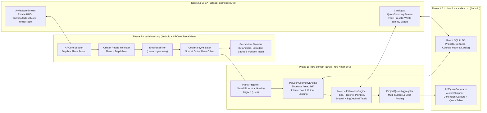

# AR Contractor Quote & Material Estimation App — Master Engineering Plan

> **Architecture Status:** **Phase 2 Complete & Verified** (`:core-domain:test` 23/23 + `:app:testDebugUnitTest` 12/12 + `:app:compileDebugKotlin` and debug APK green) — **Awaiting Review for Phase 3**
> **Target Platform:** Native Android (Min SDK 26 / Target SDK 35 / Compile SDK 36, Kotlin 2.2.0, Jetpack Compose Material 3)  
> **Offline Guarantee:** 100% On-Device Spatial Math, Room Persistence, and Vector `PdfDocument` Generation (Zero Cloud Dependencies)

---

## 1. Executive Architecture Overview

This document serves as the **single source of truth** across engineering agents and implementation phases. Every module boundary, mathematical invariant, coordinate convention, and data contract is explicitly locked here so multiple agents can execute or audit subsystems concurrently without interface drift.



---

## 2. Multi-Agent Ownership & Compile-Time Module Boundaries

To guarantee that `domain.geometry` and `domain.estimation` remain **100% free of Android framework dependencies**, the Gradle build is partitioned into two modules:

| Gradle Module | Package Namespace | Allowed Dependencies | Owning Phase / Agent Role |
| :--- | :--- | :--- | :--- |
| `:core-domain` | `com.arcontractor.estimator.domain.geometry` | Kotlin Stdlib, `java.math.BigDecimal`, JUnit 5 / JUnit 4 | **Phase 1** — Spatial Math & Geometry Agent |
| `:core-domain` | `com.arcontractor.estimator.domain.estimation` | `:core-domain` (`domain.geometry`), Kotlin Stdlib | **Phase 1** — Estimation & Costing Agent |
| `:app` | `com.arcontractor.estimator.spatial.tracking` | `:core-domain`, ARCore, SceneView (`arsceneview`), Coroutines | **Phase 2** — ARCore & Filament Rendering Agent |
| `:app` | `com.arcontractor.estimator.ui.ar` | `:core-domain`, `spatial.tracking`, Compose M3, Lifecycle VM | **Phase 2** — Spatial HUD & Compose UI Agent |
| `:app` | `com.arcontractor.estimator.data.local` | `:core-domain`, Room Runtime/KTX/KSP, Coroutines | **Phase 3** — Persistence & Catalog Agent |
| `:app` | `com.arcontractor.estimator.ui.quote` | `:core-domain`, `data.local`, Compose M3 | **Phase 3** — Quote MVI & Catalog UI Agent |
| `:app` | `com.arcontractor.estimator.data.pdf` | `:core-domain`, `android.graphics.pdf.PdfDocument`, `Canvas` | **Phase 4** — Vector Blueprint & PDF Engine Agent |

---

## 3. Architectural & Mathematical Improvements (Beyond Baseline Spec)

As Principal Spatial Computing Architects, we have incorporated **9 production-hardening improvements** addressing real-world jobsite failure modes:

1. **Compile-Time Pure JVM Isolation (`:core-domain`):**
   - Rather than relying on developer discipline inside `app/src/main`, `:core-domain` is a pure `org.jetbrains.kotlin.jvm` Gradle module. Importing `android.*` is a compile error, and `./gradlew :core-domain:test` runs instantaneously on any CI/local JVM without Robolectric or an emulator.
2. **Velocity-Adaptive & Jump-Guarded EMA Pose Filter (`EmaPoseFilter`):**
   - Supports deterministic fixed-$\alpha$ smoothing **plus** optional velocity-adaptive $\alpha \in [\alpha_{\min}, \alpha_{\max}]$ (heavy damping during fine corner aiming to kill hand-shake; low lag during fast camera sweeps) and depth-discontinuity jump recovery (`maxSnapDistanceMeters`) with spherical/renormalized surface normal smoothing.
3. **Newell's Method Best-Fit Plane + Gravity-Aligned Basis (`PlanarProjector`):**
   - Real ARCore `DepthPoint` anchors exhibit $\pm 2\text{--}15\text{ mm}$ depth noise, and the first 3 placed vertices along a baseboard or doorframe may be nearly collinear.
   - Instead of a fragile 3-point cross product, we compute the plane centroid and **Newell's method** area-weighted normal across *all* $N$ vertices (oriented consistently with an optional reference normal from ARCore's camera-facing hit pose).
   - **Gravity-Aligned `(u, v)` Axes:** For vertical/sloped walls ($|\mathbf{n} \cdot \mathbf{Y}_{\text{up}}| < 0.95$), $+\mathbf{v}$ is aligned with projected world-up $(0, 1, 0)$ and $+\mathbf{u}$ runs horizontally right. For horizontal floors/ceilings, $+\mathbf{u}$ aligns with the primary measured baseline edge. Result: **2D PDF blueprints always render walls upright with level floors and plumb doors/windows**, never tilted at arbitrary angles.
4. **Dual-Gate Coplanarity Validator (`CoplanarityValidator`):**
   - Checks **both** normal angular deviation ($\mathbf{n}_{\text{hit}} \cdot \mathbf{n}_{\text{ref}} \ge \cos \theta_{\max}$) **and** signed orthogonal plane offset ($|(\mathbf{p}_{\text{hit}} - \mathbf{p}_{\text{ref}}) \cdot \mathbf{n}_{\text{ref}}| \le d_{\max}$).
   - Prevents two common jobsite bugs: (a) wall vertices snapping onto an adjacent floor/ceiling plane, and (b) raycasts passing through an open doorway and snapping onto a parallel hallway wall 1.5 m behind the target wall.
5. **Surface Flatness / Scan Quality RMS Diagnostic (`PlanarSurfaceMetrics`):**
   - Retains each vertex's orthogonal residual distance $w_i = (\mathbf{p}_i - \mathbf{o}) \cdot \mathbf{n}$ from the best-fit plane, computing `rmsPlanarErrorMeters` and `maxPlanarDeviationMeters`. Contractors immediately see if a wall/subfloor is out-of-flat (e.g., $> 6\text{ mm}$ over $3\text{ m}$ requiring self-leveling compound or wall skimming before large-format tile).
6. **Boundary-Flush & Overlap-Safe Boolean Cutout Engine (`PolygonGeometryEngine`):**
   - Doors touch the bottom floor edge of a wall polygon ($v = 0$), which breaks naive strict point-in-polygon tests.
   - Our geometry engine validates self-intersections, enforces deterministic CCW/CW winding, supports **boundary-flush interior cutouts** (doors, baseboards, edge notches), and computes **exact boolean clipped areas** (via Sutherland-Hodgman / convex-triangulated polygon clipping + union overlap protection) so overlapping or edge-sharing cutouts never double-subtract or produce negative net area, while preserving exact `cutoutPerimeterMeters` for bullnose/J-bead/casing trim.
7. **Trade-Specific Volumetric Consumables Formulas (`MaterialEstimationEngine`):**
   - **Tiling:** Industry volumetric grout mass formula accounting for tile length, width, thickness, joint width, and cementitious density ($1.65\text{ g/cm}^3$), trowel-notch-aware thinset mortar bag estimation, and edge-trim strips from `cutoutPerimeterMeters`.
   - **Flooring:** Box rounding, underlayment rolls, and perimeter baseboard/quarter-round linear footage with miter waste.
   - **Painting:** Multi-coat finish paint gallons + optional primer coats + perimeter painter's tape rolls.
   - **Drywall:** Sheet count ($4\times 8$ / $4\times 12$), joint compound buckets, seam tape rolls, screw boxes, and cutout J-bead/corner bead strips.
8. **Deterministic Financial Arithmetic (`BigDecimal` + `HALF_UP`) & Multi-Surface Aggregation:**
   - All monetary line items (`materialSubtotal`, `consumablesSubtotal`, `laborSubtotal`, `taxAmount`, `grandTotal`) use `BigDecimal` scaled to 2 decimal places (`RoundingMode.HALF_UP`) so itemized line items always sum to the exact penny on client invoices.
   - Includes `ProjectQuoteAggregator` to roll up multi-wall / multi-room scans into a single client quote.
9. **Blank-Wall AR Resilience & CAD Blueprint Readability (Phases 2–4 Ready):**
   - Phase 2 combines Plane + DepthPoint hit-testing with feature-starvation feedback for freshly primed white drywall, plus a non-destructive Undo/Redo vertex command stack.
   - Phase 4 `PdfDocument` blueprint renderer draws outward-offset dimension leader lines, hatched cutout polygons, scale bar, and metric/imperial dual-unit labels.

---

## 4. Coordinate & Unit Conventions (Cross-Agent Contract)

- **World 3D Coordinate System:** Right-handed Y-up (matches ARCore & OpenGL/Filament): $+\mathbf{X}$ right, $+\mathbf{Y}$ up (opposite gravity), $-\mathbf{Z}$ camera forward at session origin. All internal spatial coordinates are in **meters (`Double`)**.
- **Planar 2D Coordinate System:** Orthonormal right-handed basis $(\mathbf{u}, \mathbf{v}, \mathbf{n})$ anchored at polygon centroid $\mathbf{o} \in \mathbb{R}^3$, where $\mathbf{u} \times \mathbf{v} = \mathbf{n}$. Coordinates $(u_i, v_i)$ are in **meters (`Double`)**.
- **Display & Pricing Units:** Core geometry operates in SI meters (`m`, `m²`); `UnitConverter` provides lossless conversion to Imperial (`ft`, `ft²`, architectural `ft'-in"`) so contractors can price labor/materials in either `SQ_METER` or `SQ_FOOT`.

---

## 5. Phased Execution Tracker

### Phase 1: Project Foundation, Pure Geometry Engine & Estimation Engine
- [x] `MASTER_PLAN.md` architectural specification & cross-agent contracts
- [x] Gradle multi-module setup (`settings.gradle.kts`, `build.gradle.kts`, `gradle/libs.versions.toml`, `:core-domain`, `:app`)
- [x] `domain.geometry`:
  - [x] `Vec3`, `Vec2`, `Pose3D`, `PlanarBasis` value/data structures & linear algebra operations
  - [x] `EmaPoseFilter` (fixed & velocity-adaptive EMA + normal renormalization + jump threshold)
  - [x] `CoplanarityValidator` (normal dot-product angle gate + orthogonal plane-distance gate)
  - [x] `PlanarProjector` (Newell best-fit plane, gravity-aligned orthonormal basis, 3D↔2D projection, flatness RMS metrics)
  - [x] `PolygonGeometryEngine` (Shoelace signed/unsigned area, winding normalization, self-intersection check, segment lengths, perimeter, boolean cutout subtraction & clipping)
  - [x] `UnitConverter` (meters ↔ feet/inches, $\text{m}^2 \leftrightarrow \text{ft}^2$)
- [x] `domain.estimation`:
  - [x] `TradeType`, `WastePreset`, `PricingUnit`, `MaterialSpec`, `ConsumableItem`, `SurfaceEstimate`, `ProjectQuoteSummary`
  - [x] `MaterialEstimationEngine` (gross area with waste, `ceil` box/sheet/gallon rounding, trade-specific consumables, `BigDecimal` itemized subtotals, labor, tax, grand total)
  - [x] `ProjectQuoteAggregator` (multi-surface quote roll-up)
- [x] Comprehensive JVM JUnit test suites (`:core-domain:test`) covering tilted planes, concave L-shaped rooms, wall door/window cutouts, overlapping cutouts, jitter smoothing, coplanarity rejection, and all 4 trades' estimation math

### Phase 2: ARCore + SceneView Spatial Pipeline & Compose HUD *(Complete & Verified)*
- [x] `spatial.tracking.ArSessionController`: ARCore configuration (`Config.DepthMode.AUTOMATIC`, `PlaneFindingMode.HORIZONTAL_AND_VERTICAL`, `InstantPlacementMode.DISABLED` for metric accuracy)
- [x] `spatial.tracking.ReticleHitTester`: Continuous center-screen `Frame.hitTest` prioritizing `Plane` (within polygon) > `DepthPoint`, piped through `EmaPoseFilter` and `CoplanarityValidator`
- [x] `spatial.tracking.PolygonSceneRenderer`: Filament/SceneView 3D vertex sphere nodes, dynamic cylinder/line edge extrusions, translucent triangulated surface fill, and red cutout wireframes
- [x] `ui.ar.ArMeasureViewModel` & `ArMeasureScreen`: Unidirectional MVI state machine (`Scanning` → `LockingPlane` → `PlacingOuterBoundary` → `PlacingCutout` → `Completed`), live dimension pills, flatness badge, Undo/Redo/Close Polygon controls

### Phase 3: Room Persistence, Material Catalog & Quote Summary UI *(Pending Phase 2 Review)*
- [ ] `data.local`: Room database (`AppDatabase`), entities (`ProjectEntity`, `SurfaceEntity`, `CutoutEntity`, `MaterialSpecEntity`), JSON/blob vertex type converters, DAOs, and pre-seeded contractor material catalog
- [ ] `data.repository.ProjectRepository` & `MaterialCatalogRepository` with `Flow` reactive queries
- [ ] `ui.quote`: Material Catalog editor, Trade/Waste selector, Labor & Tax adjuster, and real-time `QuoteSummaryScreen`

### Phase 4: Native Vector Blueprint & PDF Quote Generator *(Pending Phase 3 Review)*
- [ ] `data.pdf.BlueprintCanvasRenderer`: Aspect-preserving 2D $(u_i, v_i)$ bounding-box normalization, outer polygon stroke/fill, diagonal-hatched cutout zones, outward-offset edge dimension labels, scale bar, and surface summary legend
- [ ] `data.pdf.PdfQuoteGenerator`: Multi-page A4/Letter `PdfDocument` layout with contractor branding header, client metadata, vector blueprint diagram, itemized materials/consumables/labor table, tax/total summary, validity date, and client signature block + Android `FileProvider` share sheet integration

---

## 6. Cross-Agent Handoff Contracts (Phases 1 → 4)

### A. Phase 1 → Phase 2 (`domain.geometry` → `spatial.tracking` & Filament 3D Mesh)
- **Live Reticle Smoothing:** `ReticleHitTester` converts ARCore `HitResult.hitPose` into `Pose3D(position, normal, frame.timestamp)` and invokes `EmaPoseFilter.update(rawPose)`. When `FilteredPoseResult.isStableForLock == true`, the Compose reticle transitions to locked-ready state.
- **Plane Lock Enforcement:** Once vertex #1 is placed (`lockedReferencePose`), subsequent hits are gated by `CoplanarityValidator.validatePose(lockedReferencePose, candidatePose)` (and once $N \ge 3$, `validateAgainstBasis(basis, candidatePosition, candidateNormal)`).
- **Hole-Punched 3D Surface Shader Mesh:** `PolygonGeometryEngine.analyze3DSurface(...)` outputs `netSurfaceMeshTriangles2D: List<Triangle2D>`. Phase 2 maps each 2D triangle vertex back into 3D world space via `basis.unprojectTo3D(pt2D, normalOffsetMeters = 0.002)` ($2\text{ mm}$ along $+\mathbf{n}$ to eliminate depth z-fighting against real walls/floors!) so interior windows and doors appear as genuine transparent holes in the AR polygon mesh.

### B. Phase 1 → Phase 3 (`domain.*` → `data.local` Room Persistence)
- Persist **raw 3D anchors** (`outerVertices3D: List<Vec3>`, `referenceNormal: Vec3?`, and `cutouts: List<CutoutPolygonInput>`) in Room alongside `MaterialSpecEntity`.
- Reconstruct `AnalyzedSurfacePolygon` and `SurfaceEstimate` deterministically on load via `PolygonGeometryEngine.analyze3DSurface(...)` and `MaterialEstimationEngine.estimateSurface(...)` so derived metrics never go stale when material specs or waste presets are edited.

### C. Phase 1 → Phase 4 (`domain.*` → `data.pdf` Vector Blueprint & Quote PDF)
- **Blueprint Viewport Mapping:** Use `AnalyzedSurfacePolygon.boundingBox2D` (`minU`, `minV`, `maxU`, `maxV`) to compute uniform aspect-preserving scale $s = \min(W_{\text{box}} / \Delta u, H_{\text{box}} / \Delta v)$ with $12\%$ margin for dimension callouts. Note Android `Canvas` $+Y$ points downward while planar $+v$ points upward: map $(u, v) \mapsto (x_0 + (u - u_{\min}) \cdot s,\; y_0 + (v_{\max} - v) \cdot s)$ so gravity-aligned walls render right-side-up!
- **Non-Overlapping Dimension Callouts:** Offset each edge's length label outward using `EdgeSegment.outwardNormal2D(isCounterClockwise = true)`!
- **Itemized Quote Table:** Render `SurfaceEstimate.lineItems` / `ProjectQuoteSummary` directly using pre-rounded `BigDecimal` fields (`materialSubtotal`, `consumablesSubtotal`, `laborSubtotal`, `taxAmount`, `grandTotal`).

---

## 7. Multi-Agent Environment & Phase 2 Quickstart Reference

### A. Verified Build & Test Commands (macOS Toolchain Note)
Because the system default `/usr/bin/java` is JDK 24 while Android Gradle Plugin `8.13.0` (`JdkImageTransform` / `jlink`) targets JDK 17–21, **always export Android Studio's bundled JDK 21 (`JBR`)** before running `./gradlew`:

```bash
export JAVA_HOME="/Applications/Android Studio.app/Contents/jbr/Contents/Home"

# Run pure JVM geometry & estimation unit tests (23 tests, ~1s warm):
./gradlew :core-domain:test

# Verify Android app + KSP + Compose + SceneView/ARCore compilation:
./gradlew :app:compileDebugKotlin
```

> **Do NOT bump** `arsceneview` (`2.3.0`), `arcore` (`1.48.0`), or `room` (`2.7.2`) in `gradle/libs.versions.toml` without upgrading AGP to 9.1+ and installing `android-37`; the locked versions in `libs.versions.toml` are already cached and verified against `compileSdk = 36` and `AGP 8.13.0`.

### B. Verified SceneView `2.3.0` + ARCore `1.48.0` Imports for Phase 2
To prevent SceneView 1.x vs 2.x API drift, use these exact classes verified inside `io.github.sceneview:arsceneview:2.3.0` and `io.github.sceneview:sceneview:2.3.0`:
- **Compose AR Viewport:** `io.github.sceneview.ar.ARScene`, `io.github.sceneview.ar.ARSceneView`, `io.github.sceneview.rememberEngine`, `io.github.sceneview.rememberMaterialLoader`, `io.github.sceneview.rememberNodes`
- **ARCore Session & Extensions:** `com.google.ar.core.Config`, `com.google.ar.core.Frame`, `com.google.ar.core.HitResult`, `com.google.ar.core.Plane`, `com.google.ar.core.DepthPoint`, `com.google.ar.core.Point`, `com.google.ar.core.TrackingState`, `io.github.sceneview.ar.arcore.ARSession`
- **Spatial & 3D Geometry Nodes:**
  - `io.github.sceneview.ar.node.AnchorNode`, `io.github.sceneview.ar.node.PoseNode`, `io.github.sceneview.ar.node.HitResultNode`
  - `io.github.sceneview.node.SphereNode` (3D vertex pins)
  - `io.github.sceneview.node.CylinderNode` (3D extruded polygon & cutout edge segments)
  - `io.github.sceneview.node.MeshNode` / `io.github.sceneview.node.GeometryNode` + `io.github.sceneview.geometries.Geometry` (translucent polygon surface shader fill built from `AnalyzedSurfacePolygon.netSurfaceMeshTriangles2D` unprojected via `basis.unprojectTo3D(pt2D, normalOffsetMeters = 0.002)`)
  - `io.github.sceneview.loaders.MaterialLoader` (`createColorInstance(...)` for opaque vertex spheres, extruded lines, and translucent surface/cutout fills)

### C. Phase 1 Completed File Inventory
- `core-domain/src/main/kotlin/com/arcontractor/estimator/domain/geometry/`
  - `SpatialPrimitives.kt` (`Vec2`, `Vec3`, `Pose3D`, `SurfaceOrientation`, `PlanarBasis`, `BoundingBox2D`, `EdgeSegment`)
  - `UnitConverter.kt` (SI meters ↔ Imperial feet/inches & `sq ft`)
  - `EmaPoseFilter.kt` (`EmaFilterConfig`, `FilteredPoseResult`, `EmaPoseFilter`)
  - `CoplanarityValidator.kt` (`CoplanarityConfig`, `CoplanarityResult`, `CoplanarityValidator`)
  - `PlanarProjector.kt` (`PlanarProjectionResult`, `PlanarProjector`)
  - `PolygonClipping2D.kt` (`Triangle2D`, `PolygonClipping2D`)
  - `PolygonGeometryEngine.kt` (`CutoutKind`, `CutoutPolygonInput`, `AnalyzedCutout`, `AnalyzedSurfacePolygon`, `PolygonGeometryEngine`)
- `core-domain/src/main/kotlin/com/arcontractor/estimator/domain/estimation/`
  - `EstimationModels.kt` (`TradeType`, `WastePreset`, `PricingAreaUnit`, `PackageUnitType`, `TaxPolicy`, `TradeParameters`, `MaterialSpec`, `ConsumableEstimate`, `QuoteLineItem`, `SurfaceEstimate`)
  - `MaterialEstimationEngine.kt` (`MaterialEstimationEngine`)
  - `ProjectQuoteAggregator.kt` (`ProjectQuoteAggregator`, `DefaultMaterialCatalog`)

### D. Phase 2 Exit Criteria (For Phase 2 Agent)
1. Zero `TODO`s or placeholder math; all spatial filtering, coplanarity checks, and polygon triangulation must delegate to `:core-domain`.
2. Center-reticle raycast prioritizes in-polygon `Plane` hits, then `DepthPoint` hits, extracting world-space `[x, y, z]` and outward surface normal `[nx, ny, nz]`.
3. Compose MVI state machine supports: Plane scanning → Outer boundary vertex placement (with live edge length & coplanarity status) → Closing outer polygon → Optional interior/door cutout placement → Undo/Redo vertex actions → Live area/perimeter HUD.
4. Both `./gradlew :core-domain:test` and `./gradlew :app:compileDebugKotlin` (plus any Phase 2 ViewModel/state-machine unit tests in `:app:testDebugUnitTest`) pass cleanly, and Section 5 of `MASTER_PLAN.md` is updated before stopping for review.


